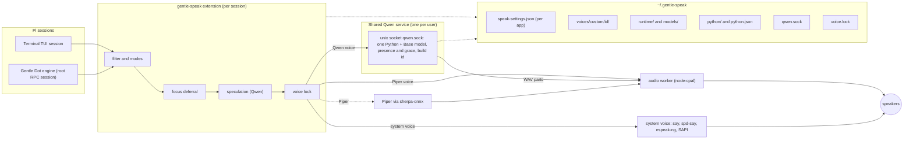

<p align="center"></p>

# gentle-speak

Opt-in, local text-to-speech for Gentle Shell (Pi): it reads the agent's questions and usable results aloud, so you do not have to read every answer after each task. Voices are Piper (small, fast), Qwen3-TTS cloned from **your own** voice or a voice you design from a text description (Apple Silicon), or your system voice. Everything runs on your machine. It can also speak inside Gentle Dot. **Automatic speech is off until you turn it on.**

**User manual:** [e-evolution.github.io/gentle-speak](https://e-evolution.github.io/gentle-speak/) · in Spanish: [manual en español](https://e-evolution.github.io/gentle-speak/es/)

## Quick start

```bash
# Once published (not published yet):
gentle-shell install npm:@e-evolution/gentle-speak

# From GitHub:
gentle-shell install git:github.com/e-Evolution/gentle-speak

# From a local checkout:
cd gentle-speak && npm ci
gentle-shell install ./
```

If Gentle Shell was already open, restart Gentle Shell (for example `gentle-shell -r` to resume your session; `/reload` can crash Gentle Shell 4.7.0, gentle-shell#2580). Pi installs packages without running install scripts, so setup happens on the **first terminal start**:

1. gentle-speak shows **one confirmation** listing what is missing and its size, then installs it in the background and ends with «gentle-speak listo». Declining is remembered (`setupOffer: "declined"`).
2. `/speak` → **Instalar todo** runs the same setup at any time.
3. `/speak doctor` (or `/speak` → **Doctor**) checks that everything works: 14 read-only checks marked ✓ / ✗ / – with a fix hint each, ending with an optional spoken test.
4. Turn speech on: `/speak` → **Toggle auto-speak** or `ctrl+alt+m`.

Try it once without installing: `gentle-shell -- -e ./extensions/gentle-speak.ts`. Requirements are in [Dependencies](#dependencies).

## Usage

**Auto-speech.** When an agent run settles, gentle-speak decides whether to speak the final assistant prose. Code blocks, diffs and tool output are never spoken, nor are turns that call tools. Modes (`/speak` → **Mode: …**):

| Mode | What is spoken |
|------|----------------|
| `questions-and-results` (default) | Final questions and usable results; plain "I'm checking…" narration is skipped |
| `all` | Every final prose answer |
| `summary` | One short Spanish sentence written by a model you choose (`/speak` → **Summary model**). No model selected: nothing is spoken |

**Keys** (rebind under `/speak` → **Key: …**, then restart Gentle Shell, for example `gentle-shell -r`; Pi/Gentle Shell reserved keys and duplicates are refused):

| Key | Action |
|-----|--------|
| `ctrl+alt+v` | `speakLast`: speak the last assistant message |
| `ctrl+alt+.` | `stop`: stop playback |
| `ctrl+alt+m` | `toggle`: auto-speech on/off |
| `ctrl+alt+n` | `cycleVoice`: next available voice |
| `ctrl+alt+c` | `toggleCopy`: speak copied selections on/off |

The model can also speak on purpose through the **`speak` tool** (text up to 4000 characters), even when auto-speech is off.

**SPEAK row.** In the interactive terminal, a `SPEAK` row appears under INTEGRATIONS, e.g. `SPEAK ● on · modo todo · Propia · Ana · ctrl+alt+m on/off · ctrl+alt+n voz · copia ○ ctrl+alt+c`. It shows state, mode, voice, your toggle/cycle keys and the copy state. It is a status row, not a clickable control (Gentle Shell has no public click API for it).

**Copy speech.** Off by default (`/speak` → **Toggle speak copied selection**). It speaks text you select and copy in *this* Gentle Shell. This feature alone needs macOS and the fullscreen TUI; the rest of gentle-speak also runs on Linux and Windows. It is gated on your own copy: the terminal app must be frontmost, and the copied text must be the visible selection. Concealed, transient and password-manager copies are skipped; clipboard text is never stored or logged.

**Focus.** Automatic speech and the `speak` tool play at once when your pane is focused. Otherwise only the latest result of that session is kept and spoken when you focus the pane (dropped on toggle off, stop, `/reload`, shutdown). Focus comes from, in order:

1. the terminal's own focus reports (pi-tui's `ESC[I` / `ESC[O`; inside tmux set `focus-events on`);
2. Herdr (`HERDR_ENV=1`, `herdr pane get $HERDR_PANE_ID`);
3. on macOS, the frontmost app (must be your terminal);
4. typing: with no focus events at all, input in the last 60 s counts as focus.

*Known limit:* Shift+F3, Alt+Shift+F3 and Ctrl+F3 send `ESC[1;<modifier>R`, byte for byte the terminal's cursor-position reply for row 1, which is not treated as typing. Those three keys alone do not count as presence (every other modified key does); the focus events and the other sources are unaffected.

When focus is unknown, the turn is spoken in order and starts with the project name: `my-project: …`. `HERDR_BIN_PATH` is honored only as an absolute path to an executable `herdr`.

**One voice at a time.** Every playback holds a cross-process lock in `~/.gentle-speak/`, so sessions (terminals, Herdr panes, Gentle Dot) take turns and never overlap. A lock whose owner died is reclaimed. Your stop key stops only your own session.

RPC, print, JSON and delegated child sessions never speak (except Dot's own root session, see [Gentle Dot](#gentle-dot)). `/reload` and shutdown stop audio and drop pending speech.

## Architecture



- **Sessions and extension.** Each Pi session loads the extension. It filters the settled answer (the [Usage](#usage) rules above), defers it while the pane is unfocused, can synthesize completed sentences ahead of time while the answer streams (Qwen voices only), and takes the voice lock for the whole playback. A Gentle Dot session works the same way, without focus deferral and with a `Dot:` prefix.
- **Shared Qwen service.** One detached Node process per user owns the single Qwen Python worker and model, on the private unix socket `~/.gentle-speak/qwen.sock` (0600 in a 0700 dir). Every terminal session and Dot connect to it; the voice-lock holder goes before speculative work. Each session keeps one presence connection, so the model stays loaded while any session is open; after the last one leaves, a grace period (`qwenIdleMinutes`, default 10) runs before it unloads and exits. A **build id** (a hash of the service and worker scripts) is part of the handshake: a service built from different code is replaced, so a stale service never survives an update. If the service cannot run, a session falls back to its own Python worker.
- **Audio worker.** A Node child process (`scripts/speak-worker.cjs`) plays audio through node-cpal, opening the output device's own default config and resampling in-process (it never asks the device to change sample rate; Bluetooth-friendly).
- **Piper.** The Piper `es_MX` / `es_ES` voices synthesize in the audio worker with sherpa-onnx; no Python.
- **System voice.** macOS `say`, Linux `spd-say` or `espeak-ng`/`espeak`, Windows SAPI through PowerShell. The text always travels on stdin. No download.
- **`~/.gentle-speak` layout:**

| Path | Holds |
|------|-------|
| `speak-settings.json` | Settings (per app, see [Configuration](#configuration)) |
| `runtime/` | Native audio runtime (sherpa-onnx + node-cpal) |
| `models/` | Piper voice bundles |
| `voices/custom/<id>/` | Your own Qwen reference voices |
| `python/`, `python.json` | gentle-speak's Python env with mlx-audio, and the record of its interpreter |
| `qwen.sock`, `qwen-service.pid`, `qwen-service.log` | The shared Qwen service |
| `voice.lock/` | The cross-process voice lock |

The Qwen models themselves live in the Hugging Face cache (`HF_HOME`, default `~/.cache/huggingface`).

## How the Qwen models are used

Qwen voices need macOS on Apple Silicon (mlx-audio).

- **VoiceDesign 1.7B** (`mlx-community/Qwen3-TTS-12Hz-1.7B-VoiceDesign-bf16`) is used **only to create a voice** from a text description. It is a separate, explicit, confirmed download, never automatic.
- **Base 0.6B** (`mlx-community/Qwen3-TTS-12Hz-0.6B-Base-bf16`) **clones a reference WAV for every utterance**. Speaking always uses the Base model with your voice's reference audio and exact transcript.
- **Streamed parts.** Audio is sent as each ~2 s part is synthesized, so the first sound starts after about 1.5 s on a warm model instead of waiting for the whole text.
- **Speculative synthesis.** While the answer is still being written, completed sentences are synthesized ahead (one stream, at most 500 characters ahead). Nothing plays before the answer settles; then audio matching the final spoken text plays at once and only the rest is synthesized. Mismatches, tool-call turns, stop, toggle off, voice change and shutdown delete the prepared audio. It does not apply to `summary` mode, Piper, copy speech or the speak-last key.
- **One shared service**, kept loaded while any session is open (about 2.6 GB once, not once per session), with a grace of 10 minutes after the last session by default. `/speak` → **Mantener Qwen tras cerrar la última sesión** sets it to 1, 2, 5, 10, 30, 60 min or **Nunca**; **Detener servicio Qwen** stops it now.
- A speed other than 1 on Qwen voices needs `ffmpeg` (optional); without it they play at native speed and say so once.

## Your own voice

No Qwen voice is bundled; you provide yours. Under `/speak`:

| Item | What it does |
|------|--------------|
| **Crear voz propia…** | Designs a voice from a text description (10–600 characters), a name and a sample sentence, with VoiceDesign. Asks first to download that model, showing its size. Uses only your text, no audio of anyone |
| **Importar mi grabación…** | Clones a recording: an absolute path to a PCM WAV of **3–30 s**, its **exact transcript**, a name, after an explicit consent confirmation («Es mi voz o tengo consentimiento explícito de la persona») |
| **Borrar voz propia…** | Deletes a voice after confirmation |

Each voice lives in `~/.gentle-speak/voices/custom/<id>/` (`reference.wav` plus `voice.json` with id, label, transcript, description, language, source `designed` or `recorded`, created and **sha256**) and is selected as `custom:<id>`. The sha256 is verified at use; a missing or invalid voice is skipped with a notice and falls back like any missing voice.

**Configure it:** choose `Voice: Propia · <label> (custom:<id>) — installed` in `/speak`, press `cycleVoice` (`ctrl+alt+n`), or pick it in Dot's voice picker (`/speak` → **Gentle Dot** → **Voz de Dot**). Voices stay local and are never uploaded; never clone a real person without their consent.

**Migration.** Earlier releases shipped seven built-in `qwen-*` reference voices. At the next session start, an existing `voices/qwen3/` install with a valid manifest is converted once into custom voices (same label, transcript and sha256; WAVs copied, nothing deleted), and settings that say `qwen-<name>` are mapped to `custom:<name>` for the terminal and Dot.

## Configuration

Settings are in `speak-settings.json` (schema `gentle-speak.settings/v1`, written atomically, mode 0600). A missing or malformed file means off. Use `/speak` rather than editing it.

| Key | Default | Meaning |
|-----|---------|---------|
| `enabled` | `false` | Automatic speech |
| `mode` | `questions-and-results` | `all`, `questions-and-results` or `summary` |
| `voice` | `es_MX` | `es_MX`, `es_ES`, `mac` (system voice) or `custom:<id>` |
| `speed` | `1` | 0.5–2 |
| `summaryModel` | `null` | `{provider, id}` of the model for `summary` mode |
| `copySpeech` | `false` | Speak copied selections (macOS) |
| `macVoice` | `null` | System voice name; `null` picks the best installed Spanish voice |
| `macFallback` | `true` | Speak with the system voice when the chosen voice is missing or fails |
| `qwenIdleMinutes` | `10` | Grace after the last session before the Qwen service unloads (1–60, `null` = never) |
| `shortcuts` | see [Usage](#usage) | `speakLast`, `stop`, `toggle`, `cycleVoice`, `toggleCopy` |
| `dotSpeech`, `dotOffer`, `setupOffer` | `false`, `null`, `null` | Legacy Dot flag (ignored now); remembered declines of the Dot and setup offers |

**`/speak` menu:** Gentle Dot · Toggle auto-speak · Mode: all / questions-and-results / summary · Summary model · Voice: … (every voice, with its state) · Crear voz propia… · Importar mi grabación… · Borrar voz propia… · Voz del sistema · Toggle Mac fallback · Mantener Qwen tras cerrar la última sesión · Detener servicio Qwen · Speed · Key: … · Install voice and runtime (Piper voice and native runtime, confirmed separately) · Instalar todo · Doctor · Toggle speak copied selection · Stop playback.

**System voice.** `Voz del sistema` lists the platform's Spanish voices or `Auto` (macOS Paulina, then Mónica; Windows Sabina, Helena; Linux Latin-American Spanish, then `es`). The label reads `Mac` on macOS and `Sistema` elsewhere; the id stays `mac`. It is also the fallback when the selected Piper or Qwen voice is not installed or fails (you are told once per session; a stop or cancel never falls back).

**Per app.** Each app reads `$HOME/.gentle-speak/speak-settings.json`: the terminal's is `~/.gentle-speak/`, Gentle Dot's is `<Dot HOME>/.gentle-speak/`. Assets and the voice lock are always shared from the real `~/.gentle-speak`.

## Gentle Dot

gentle-speak can speak inside Gentle Dot's engine without changing Dot.

- **Offer.** On the first terminal start, if Dot's `settings.json` (`GENTLE_DOT_AGENT_HOME`, default `~/.gentle-dot/agent`) does not list gentle-speak, you are asked once: «Encontré Gentle Dot. ¿Querés que también hable ahí?». **No** is remembered (`dotOffer: "declined"`).
- **Connect / disconnect.** **Yes**, or `/speak` → **Gentle Dot** → **Conectar Gentle Dot**, backs up Dot's `settings.json` (`settings.json.gentle-speak-backup-<timestamp>`), adds the package and seeds Dot's own speak settings from the terminal's (`enabled: true`, `copySpeech: false`). **Desconectar Gentle Dot** backs up, removes only our entry and sets Dot's `enabled: false`; its settings file is kept. A malformed file is never written. Restart Dot afterwards.
- **Submenu** `/speak` → **Gentle Dot**: state, Conectar/Desconectar, **Hablar en Dot**, **Voz de Dot**, **Modo de Dot**.
- **Own settings.** `<Dot HOME>/.gentle-speak/speak-settings.json`, where Dot's HOME is `dirname(<Dot agent home>)/home` (`GENTLE_DOT_HOME` overrides). Dot speaks only if its own `enabled` is true. Runtime, models, voices, the Hugging Face cache, the Qwen service and the voice lock are shared, so nothing downloads twice and Dot never overlaps the terminal.
- **Mute Dot's own voice.** Use Dot's **«Mute spoken replies»** button (speaker icon in the chat header); otherwise you hear every answer twice.
- **What speaks.** Only Dot's root RPC session, with the same voice, mode, filter, speculation and voice lock, taking its turn at once and prefixing every text with `Dot: `. No SPEAK row, shortcuts or copy speech there.
- **Accepted package sources**, nothing else: an absolute local directory whose `package.json` name is `@e-evolution/gentle-speak` (or the legacy `gentle-speak`); `npm:@e-evolution/gentle-speak[@version]` (or the legacy `npm:gentle-speak[@version]`); or a git source of a repository named `gentle-speak`: `git:<host>/<owner>/gentle-speak[.git][@ref]` or `https://<host>/<owner>/gentle-speak[.git][@ref]`. Credentials, queries, fragments, ssh/file forms and other names are refused and nothing is written.

## Supported engines

| Engine | Needs | Offers |
|--------|-------|--------|
| **Piper** via sherpa-onnx | Native runtime (about 18 MB, downloaded) + a voice bundle (es_MX about 67 MB; es_ES optional) | Local, fast, no cloning; fixed voices `es_MX` (default) and `es_ES` |
| **Qwen3-TTS** via mlx-audio | macOS on Apple Silicon, own Python env, Base 0.6B model (VoiceDesign 1.7B to design) | Clones a reference WAV for every utterance; your own or designed voices |
| **System voice** (`say` / `spd-say` / `espeak-ng` / SAPI) | Nothing to download | Extra voice and automatic fallback |

**Other engines and models are not supported yet.** A voice made with any other tool can still be used: import its audio as a reference WAV («Importar mi grabación…») and Qwen clones it (3–30 s, exact transcript, and only with consent).

## Dependencies

**Installed automatically** by the one-confirmation setup (sizes shown to you before anything downloads):

| Component | Size | Where |
|-----------|------|-------|
| Native audio runtime (sherpa-onnx + node-cpal) | about 18 MB | `~/.gentle-speak/runtime/` |
| Piper `es_MX` voice | about 67 MB | `~/.gentle-speak/models/` |
| Python env with `mlx-audio==0.4.4` and its hash-locked dependencies (Apple Silicon only) | about 480 MB on disk | `~/.gentle-speak/python/` (uv, else `python3 -m venv`; no sudo, system Python untouched) |
| Qwen3-TTS Base 0.6B model (Apple Silicon only) | about 2.5 GB | Hugging Face cache |

The VoiceDesign 1.7B model is **never** part of setup: it is downloaded only if you choose «Crear voz propia…» and confirm. Each download is verified (pinned hashes for the runtime and Piper bundles).

What the Python step fetches and writes:

- The Python packages come from PyPI as a hash-locked set: `mlx-audio==0.4.4` and every dependency, each pinned to one version with its sha256 hashes, listed in `scripts/requirements-qwen.txt` and installed with `--require-hashes`. A package whose hash does not match is refused. An environment installed by an earlier release without this lock is offered again in «Instalar todo» (`/speak doctor` reports it), and the lock is installed into the same environment.
- When Python 3.12 is missing, `uv` may download a CPython build into its own directory, `~/.local/share/uv/python`.
- pip or uv keep their usual download cache, and the models go to the Hugging Face cache (`HF_HOME`, default `~/.cache/huggingface`).
- The installers run from `~/.gentle-speak`, never from your current project, and `uv` runs with `--no-config`. A `uv.toml`, `pip/` or `venv/` in the directory where you started Gentle Shell cannot change what is installed.

**You provide:**

- Gentle Shell (Pi) and Node.js ≥ 24.
- For Qwen: macOS on Apple Silicon, and `uv` **or** Python ≥ 3.12. Without either, setup shows how to install one and installs nothing else.
- Optional: `ffmpeg` (speed changes on Qwen voices only). Setup detects it and shows `brew install ffmpeg`; it never installs system packages.
- Linux system voice: `sudo apt install speech-dispatcher espeak-ng`. macOS and Windows need nothing.

## Platform support

| Feature | macOS arm64 | macOS Intel | Linux | Windows |
|---------|:-----------:|:-----------:|:-----:|:-------:|
| Piper (native runtime) | ✓ | runtime target exists | x64/arm64 targets, fakes only | x64 target, fakes only |
| Qwen3-TTS | ✓ | ✗ (Apple Silicon only) | ✗ | ✗ |
| System voice | ✓ (`say`) | ✓ (`say`) | fakes only | fakes only |
| Copy speech | ✓ | ✓ | ✗ | ✗ |
| Terminal focus events | ✓ | ✓ | ✓ if the terminal sends them | same |
| Herdr focus | ✓ (where Herdr runs) | same | same | same |
| Gentle Dot | ✓ | untested | untested | untested |

Only macOS arm64 has been run live. **Linux and Windows are verified with fakes only, not live** (the `spd-say`, `espeak-ng` and SAPI flags come from the tools' documentation), and Intel macOS is untested. Linux native binaries need glibc ≥ 2.34.

## Privacy

- Everything runs locally: synthesis, voices and the Qwen service. No audio or voice is uploaded.
- `summary` mode sends sanitized final prose (never tool output) to the model **you** pick, which may be a cloud provider with its usual costs. Without a chosen model nothing is sent.
- Imported recordings need explicit consent that the voice is yours or that you have permission. Designed voices use only your text.
- Copy speech skips concealed, transient and password-manager clipboard content, and never logs clipboard text.
- Downloads come only from the pinned npm/GitHub sources, PyPI (the Python packages), a `uv`-managed CPython when Python 3.12 is missing, and Hugging Face, after your confirmation.
- No network request happens before the setup confirmation: the sizes it shows are pinned approximate values, not looked up. The same holds for the VoiceDesign download.
- Setup writes pip or uv caches and the Hugging Face cache besides `~/.gentle-speak` (see Dependencies).

## Troubleshooting

- **Start with `/speak doctor`.** It reports the runtime, audio device, models, Python env, Qwen service, voice lock, ffmpeg, system voice, Herdr focus and Dot connection, with a fix hint for each ✗.
- **«Qwen synthesis failed».** Usually a stale shared service. It is now replaced automatically when its build id differs; otherwise `/speak` → **Detener servicio Qwen** and speak again. If it persists, check that mlx-audio and the Base model are installed (doctor) and read `~/.gentle-speak/qwen-service.log`.
- **Bluetooth headsets.** Playback uses the device's own sample rate and tolerates the buffer underruns (xruns) Bluetooth can produce; you may still hear small glitches. A failure reports `Audio playback failed: <cause>`.
- **No sound when unfocused.** That is the focus deferral: the result is kept until you focus the pane. If focus is unknown it speaks in turn with a project prefix.
- **`/reload` crashes Gentle Shell.** That is a gentle-pi issue, not gentle-speak. Restart Gentle Shell instead (for example `gentle-shell -r` to resume your session).
- **Linux/Windows system voice silent.** Install the tools listed in [Dependencies](#dependencies); these paths are unverified live. On Windows the voice needs `powershell.exe` on `PATH`; without it the system voice is reported as unavailable (doctor: «falta `powershell.exe` en el PATH»). The voice listing is bounded (8 s) and an unanswered listing counts as no voices.
- **Linux `spd-say` keeps talking after stop.** Stop (and a timeout) kills `spd-say` and then runs `spd-say -C`, which cancels everything speech-dispatcher has queued, including other applications' speech (it cannot cancel only ours). Unverified live.

## License and attribution

gentle-speak is [MIT](LICENSE), Copyright (c) 2026 e-Evolution Consultants S.A. It is **not affiliated with Gentleman Programming**; it is built for Gentle Shell (gentle-pi, MIT, by Mario Zechner).

[THIRD_PARTY_NOTICES.md](THIRD_PARTY_NOTICES.md) lists every component and its license. In short:

- The package ships only gentle-speak's own code plus `seek-bzip` (MIT) as a normal npm dependency; Pi packages are peers.
- The runtime (sherpa-onnx, onnxruntime, node-cpal), Piper voices, mlx-audio and the Qwen3-TTS models are **downloaded by you from their upstream sources and never redistributed** by this package. Their licenses are permissive (Apache-2.0, MIT, ISC, CC0), and model cards are the authority for the voices and models.
- **espeak-ng (GPL-3.0-or-later).** The prebuilt sherpa-onnx binaries include espeak-ng, a GPL-3.0 component. Because you download them from upstream and gentle-speak does not bundle them, gentle-speak stays MIT. **If you bundle the runtime or `espeak-ng-data` yourself, you take on GPL-3.0 obligations.**
- Some licenses (onnxruntime, node-cpal's Rust crates, mlx-audio's transitive dependencies, external tools) are still unverified; see the notices.

## Development

`npm test` runs the whole suite (Node ≥ 24, `node --test`) behind a real-home guard: tests run with injected temporary homes and fail if anything reads or writes the real `~/.gentle-speak`, `~/.gentle-dot`, `~/.gentle-shell` or `~/.pi`. The published package is an allowlist (`files` in `package.json`), and CI checks it. See [CONTRIBUTING.md](CONTRIBUTING.md) to contribute, [SECURITY.md](SECURITY.md) to report a vulnerability and [CHANGELOG.md](CHANGELOG.md) for history.
