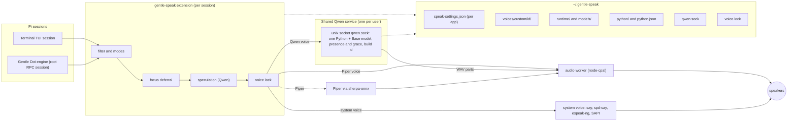

# Architecture
{: .no_toc }

1. TOC
{:toc}

---

## Overview

## The parts

### Sessions and the extension

Each Pi session loads the extension. When an answer settles, the extension:

1. filters it (see [What gets spoken](usage.md#what-gets-spoken));
2. defers it while the pane does not have focus (see [Focus](usage.md#focus-with-several-panes));
3. for Qwen voices, may already have synthesized completed sentences while the answer was streaming (see [Speculative synthesis](#speculative-synthesis));
4. takes the voice lock for the whole playback.

A Gentle Dot session works the same way, without focus deferral and with a `Dot: ` prefix.

### The audio worker

A Node child process (`scripts/speak-worker.cjs`) plays audio through node-cpal. It opens the output device with the device's own default configuration and resamples in-process. It never asks the device to change its sample rate, which keeps Bluetooth headsets happy.

### Piper

The Piper `es_MX` and `es_ES` voices synthesize inside the audio worker with sherpa-onnx. No Python is involved.

### The system voice

macOS `say`, Linux `spd-say` or `espeak-ng` / `espeak`, and Windows SAPI through PowerShell. The text always travels on standard input. Nothing is downloaded.

## How the Qwen models are used

Qwen voices need macOS on Apple Silicon. They run with mlx-audio in gentle-speak's own Python environment.

| Model | Used for | Download |
|-------|----------|----------|
| **VoiceDesign 1.7B** (`mlx-community/Qwen3-TTS-12Hz-1.7B-VoiceDesign-bf16`) | **Only to create a voice** from a text description | Separate, explicit and confirmed; never automatic |
| **Base 0.6B** (`mlx-community/Qwen3-TTS-12Hz-0.6B-Base-bf16`) | **Every utterance**: it clones your voice's reference WAV, using its exact transcript | Part of the setup on Apple Silicon |

### Streamed parts

Audio is sent as each part of about 2 seconds is synthesized. On a warm model, the first sound starts after about 1.5 seconds instead of waiting for the whole text.

### Speculative synthesis

While the answer is still being written, completed sentences are synthesized ahead, in one stream and at most 500 characters ahead.

- Nothing plays before the answer settles. Then the audio that matches the final spoken text plays at once, and only the rest is synthesized.
- A mismatch, a turn that calls tools, stop, turning speech off, a voice change or shutdown deletes the prepared audio.
- It does not apply to `summary` mode, Piper, copy speech or the speak-last key.

### Speed

A speed other than 1 on Qwen voices needs `ffmpeg`, which changes the tempo without changing the pitch. Without it, Qwen voices play at their native speed and say so once.

## The shared Qwen service

One detached Node process per user owns the single Qwen Python worker and the loaded Base model.

- **One model in memory.** It is loaded once (about 2.6 GB of memory), not once per session.
- **A private socket.** It listens on the Unix socket `~/.gentle-speak/qwen.sock`, mode 0600, in a 0700 directory. Every terminal session and Gentle Dot connect to it.
- **Order.** The session holding the voice lock goes before speculative work from other sessions.
- **Presence and idle grace.** Each session keeps one presence connection, so the model stays loaded while any session is open. After the last session leaves, a grace period runs before the service unloads the model and exits. It is `qwenIdleMinutes`, 10 minutes by default; set it with `/speak` → **Mantener Qwen tras cerrar la última sesión** (1, 2, 5, 10, 30 or 60 minutes, or **Nunca**).
- **Build id.** The handshake carries a build id: the first 12 hex characters of a sha256 over the service and worker scripts. A service built from different code is replaced through a graceful restart: the old one finishes what it already queued, then exits. A stale service never survives an update. Restarts are rate-limited to one every 30 seconds.
- **Fallback.** If the service cannot run, a session falls back to its own Python worker.
- **Stop it now** with `/speak` → **Detener servicio Qwen**. The next Qwen speech starts it again.

Its files are `qwen.sock`, `qwen-service.pid` and `qwen-service.log` in `~/.gentle-speak`.

## The voice lock

Every playback, from any session, holds one cross-process lock: the `voice.lock/` directory in the shared `~/.gentle-speak`. Sessions in different terminals, Herdr panes and Gentle Dot take turns and never overlap.

- The lock directory is created whole, with an owner file (process id, time and a token), so it never exists without its owner.
- Only the owner releases its lock.
- A lock whose owner process died is reclaimed by the next session that wants to speak, under a separate `voice.reclaim/` mutex.
- Your stop key stops only your own session.

`/speak doctor` shows whether the lock is free, held by a live process, or left by a dead one.

## The gentle-speak folder

Everything gentle-speak writes lives in `~/.gentle-speak` (except the caches listed below).

| Path | Holds |
|------|-------|
| `speak-settings.json` | Settings (one per app; see [Configuration](configuration.md#the-settings-file)) |
| `runtime/` | The native audio runtime (sherpa-onnx + node-cpal) |
| `models/` | Piper voice bundles |
| `voices/custom/<id>/` | Your own Qwen voices (`reference.wav` and `voice.json`) |
| `python/`, `python.json` | gentle-speak's Python environment with mlx-audio, and the record of its interpreter |
| `qwen.sock`, `qwen-service.pid`, `qwen-service.log` | The shared Qwen service |
| `voice.lock/` | The cross-process voice lock |
| `focus.log` | Notes written when terminal focus events are unavailable |

Outside it:

- the Qwen models, in the Hugging Face cache (`HF_HOME`, default `~/.cache/huggingface`);
- pip or uv download caches;
- when Python 3.12 is missing, a CPython build that `uv` may download into `~/.local/share/uv/python`.
