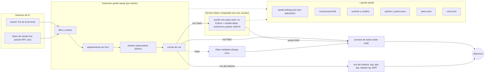

# Arquitectura
{: .no_toc }

1. TOC
{:toc}

---

## Vista general

## Las partes

### Las sesiones y la extensión

Cada sesión de Pi carga la extensión. Cuando una respuesta termina, la extensión:

1. la filtra (consulta [Qué se lee en voz alta](uso.md#qué-se-lee-en-voz-alta));
2. la aplaza mientras el panel no tenga el foco (consulta [Foco](uso.md#foco-con-varios-paneles));
3. en las voces Qwen, puede que ya haya sintetizado las frases completas mientras la respuesta se generaba (consulta [Síntesis especulativa](#síntesis-especulativa));
4. toma el cerrojo de voz durante toda la reproducción.

Una sesión de Gentle Dot funciona igual, sin aplazamiento por foco y con el prefijo `Dot: `.

### El proceso de audio

Un proceso hijo de Node (`scripts/speak-worker.cjs`) reproduce el audio mediante node-cpal. Abre el dispositivo de salida con la configuración predeterminada del propio dispositivo y remuestrea dentro del proceso. Nunca le pide al dispositivo que cambie su frecuencia de muestreo, lo que evita problemas con los auriculares Bluetooth.

### Piper

Las voces Piper `es_MX` y `es_ES` sintetizan dentro del proceso de audio con sherpa-onnx. No interviene Python.

### La voz del sistema

`say` en macOS, `spd-say` o `espeak-ng` / `espeak` en Linux, y SAPI mediante PowerShell en Windows. El texto siempre viaja por la entrada estándar. No se descarga nada.

## Cómo se usan los modelos Qwen

Las voces Qwen necesitan macOS en Apple Silicon. Se ejecutan con mlx-audio en el propio entorno de Python de gentle-speak.

| Modelo | Se usa para | Descarga |
|--------|-------------|----------|
| **VoiceDesign 1.7B** (`mlx-community/Qwen3-TTS-12Hz-1.7B-VoiceDesign-bf16`) | **Solo para crear una voz** a partir de una descripción en texto | Aparte, explícita y confirmada; nunca automática |
| **Base 0.6B** (`mlx-community/Qwen3-TTS-12Hz-0.6B-Base-bf16`) | **Cada frase**: clona el WAV de referencia de tu voz, usando su transcripción exacta | Parte de la instalación en Apple Silicon |

### Partes en streaming

El audio se envía a medida que se sintetiza cada parte de unos 2 segundos. Con el modelo ya cargado, el primer sonido empieza a los 1.5 segundos aproximadamente, en vez de esperar a todo el texto.

### Síntesis especulativa

Mientras la respuesta todavía se está escribiendo, las frases completas se sintetizan por adelantado, en un solo flujo y con 500 caracteres de adelanto como máximo.

- No suena nada antes de que la respuesta termine. Entonces el audio que coincide con el texto final que se va a leer suena de inmediato, y solo se sintetiza el resto.
- Una discrepancia, un turno que llama a herramientas, una parada, apagar la voz, un cambio de voz o el cierre borran el audio preparado.
- No se aplica al modo `summary`, a Piper, a la lectura de lo copiado ni a la tecla para leer el último mensaje.

### Velocidad

Una velocidad distinta de 1 en las voces Qwen necesita `ffmpeg`, que cambia el tempo sin cambiar el tono. Sin él, las voces Qwen suenan a su velocidad nativa y lo dicen una vez.

## El servicio Qwen compartido

Un proceso de Node independiente por usuario es dueño del único proceso de Python de Qwen y del modelo Base cargado.

- **Un modelo en memoria.** Se carga una sola vez (unos 2.6 GB de memoria), no una vez por sesión.
- **Un socket privado.** Escucha en el socket Unix `~/.gentle-speak/qwen.sock`, con modo 0600, en un directorio 0700. Todas las sesiones de terminal y Gentle Dot se conectan a él.
- **Orden.** La sesión que tiene el cerrojo de voz va antes que el trabajo especulativo de otras sesiones.
- **Presencia y periodo de gracia.** Cada sesión mantiene una conexión de presencia, así que el modelo sigue cargado mientras haya alguna sesión abierta. Cuando sale la última sesión, corre un periodo de gracia antes de que el servicio descargue el modelo y termine. Es `qwenIdleMinutes`, 10 minutos por defecto; se ajusta con `/speak` → **Mantener Qwen tras cerrar la última sesión** (1, 2, 5, 10, 30 o 60 minutos, o **Nunca**).
- **Build id (identificador de compilación).** El saludo inicial lleva un build id: los primeros 12 caracteres hexadecimales de un sha256 calculado sobre los scripts del servicio y del proceso de Python. Un servicio compilado a partir de otro código se sustituye mediante un reinicio ordenado: el antiguo termina lo que ya tenía en cola y después sale. Un servicio desactualizado nunca sobrevive a una actualización. Los reinicios están limitados a uno cada 30 segundos.
- **Respaldo.** Si el servicio no puede ejecutarse, la sesión recurre a su propio proceso de Python.
- **Detenlo ahora** con `/speak` → **Detener servicio Qwen**. La siguiente frase con Qwen lo vuelve a iniciar.

Sus archivos son `qwen.sock`, `qwen-service.pid` y `qwen-service.log` en `~/.gentle-speak`.

## El cerrojo de voz

Cada reproducción, desde cualquier sesión, toma un único cerrojo entre procesos: el directorio `voice.lock/` en el `~/.gentle-speak` compartido. Las sesiones de distintas terminales, los paneles de Herdr y Gentle Dot se turnan y nunca se solapan.

- El directorio del cerrojo se crea completo, con un archivo de propietario (identificador de proceso, hora y un token), así que nunca existe sin su propietario.
- Solo el propietario libera su cerrojo.
- Un cerrojo cuyo proceso propietario murió lo recupera la siguiente sesión que quiera hablar, bajo un mutex aparte, `voice.reclaim/`.
- Tu tecla de parada solo detiene tu propia sesión.

`/speak doctor` muestra si el cerrojo está libre, lo tiene un proceso vivo o lo dejó uno muerto.

## La carpeta de gentle-speak

Todo lo que escribe gentle-speak vive en `~/.gentle-speak` (salvo las cachés que se indican más abajo).

| Ruta | Contiene |
|------|----------|
| `speak-settings.json` | Los ajustes (uno por aplicación; consulta [Configuración](configuracion.md#el-archivo-de-ajustes)) |
| `runtime/` | El runtime nativo de audio (sherpa-onnx + node-cpal) |
| `models/` | Los paquetes de voces Piper |
| `voices/custom/<id>/` | Tus propias voces Qwen (`reference.wav` y `voice.json`) |
| `python/`, `python.json` | El entorno de Python de gentle-speak con mlx-audio, y el registro de su intérprete |
| `qwen.sock`, `qwen-service.pid`, `qwen-service.log` | El servicio Qwen compartido |
| `voice.lock/` | El cerrojo de voz entre procesos |
| `focus.log` | Notas que se escriben cuando no hay eventos de foco de la terminal |

Fuera de ella:

- los modelos Qwen, en la caché de Hugging Face (`HF_HOME`, por defecto `~/.cache/huggingface`);
- las cachés de descarga de pip o uv;
- cuando falta Python 3.12, una compilación de CPython que `uv` puede descargar en `~/.local/share/uv/python`.
